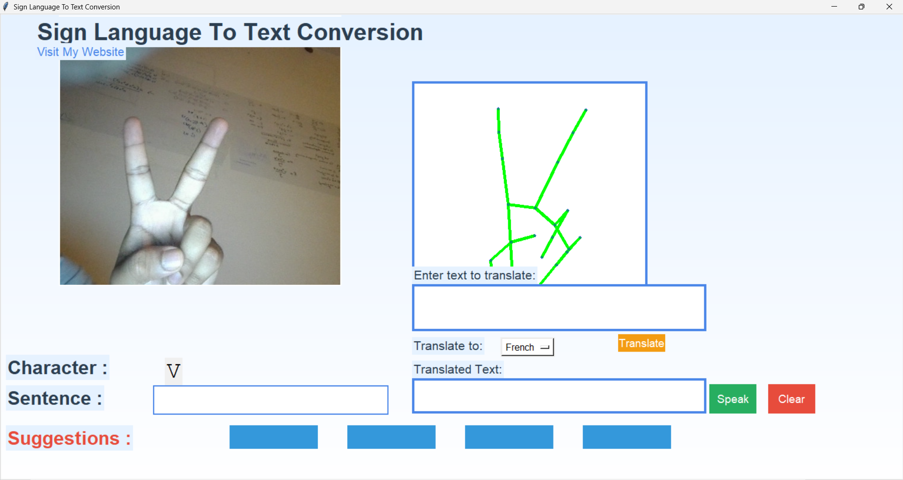
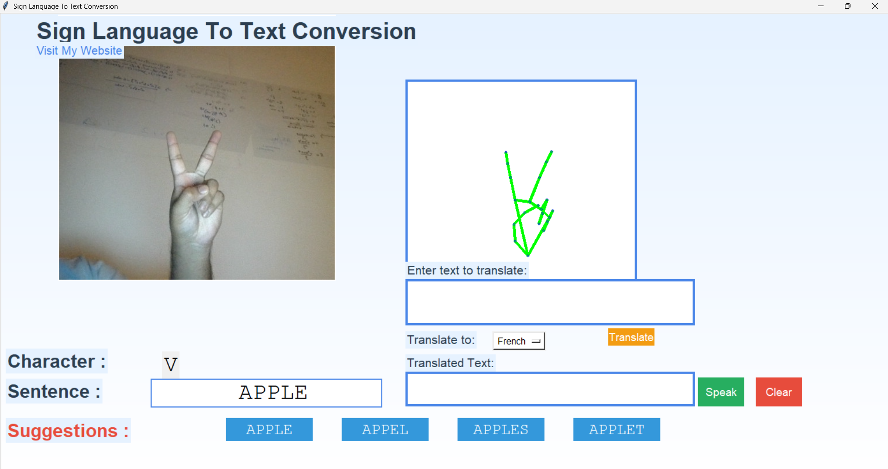
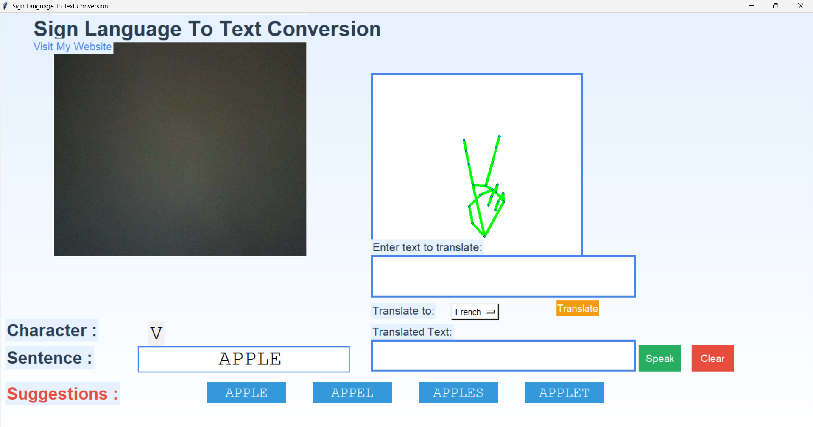

# 🤟 Sign Language Recognition using Machine Learning

A real-time AI-powered system that translates hand sign gestures into text and spoken audio, featuring auto-word completion, text-to-speech, and multilingual translation powered by Gemini AI.

---

## 📸 Screenshots & Demo

### 1. Real-Time Sign Recognition Interface


### 2. Sentence Construction & Word Suggestions


### 3. Translation & Text-to-Speech


---

## ✨ Features

- **Real-Time Hand Detection**: Uses **MediaPipe** and **cvzone** (`HandDetector`) to accurately capture and track 21 hand skeletal landmarks in real time.
- **Deep Learning CNN Model**: Classifies hand skeleton representations into sign language letters using a trained Convolutional Neural Network (`cnn8grps_rad1_model.h5`).
- **Word Completion & Spell Check**: Suggests likely words as you sign using `pyenchant` dictionary support.
- **Text-to-Speech (TTS)**: Built-in voice engine powered by `pyttsx3` to speak aloud recognized sentences.
- **Multilingual Translation**: Seamlessly translates text into French, Spanish, German, Hindi, Japanese, and Arabic using **Google Gemini AI**.
- **Modern Tkinter GUI**: Clean, styled desktop user interface with webcam feed and sign visualization panels.

---

## 🛠️ Project Structure

```text
├── app.py                     # Main application (Tkinter GUI, vision pipeline, inference)
├── cnn8grps_rad1_model.h5     # Trained CNN model weights
├── white.jpg                  # Canvas template for hand skeleton drawing
├── requirements.txt           # Python dependencies
├── .gitignore                 # Git ignore rules
├── screenshot1.png            # Application preview 1
├── screenshot2.png            # Application preview 2
├── screenshot3.png            # Application preview 3
└── README.md                  # Project documentation
```

---

## 🚀 Getting Started

### 1. Clone the Repository
```bash
git clone https://github.com/MaazFakhroo/SLR-using-machine-learning.git
cd SLR-using-machine-learning
```

### 2. Set Up Virtual Environment (Recommended)
```bash
# Windows
python -m venv venv
venv\Scripts\activate

# macOS / Linux
python3 -m venv venv
source venv/bin/activate
```

### 3. Install Dependencies
```bash
pip install -r requirements.txt
```

> **Note**: For compatibility between MediaPipe and Keras, make sure `protobuf<5` and `numpy<2` are installed (already pinned in `requirements.txt`).

### 4. (Optional) Set Your Gemini API Key
To use the multilingual translation feature, open `app.py` and insert your Google Gemini API key:
```python
genai.configure(api_key="YOUR_GEMINI_API_KEY")
```

### 5. Launch the Application
```bash
python app.py
```

---

## 🧰 Tech Stack

- **Python 3.10 - 3.12**
- **OpenCV & cvzone**: Camera capture and computer vision
- **MediaPipe**: Hand tracking and landmark extraction
- **TensorFlow & Keras**: Deep learning CNN model inference
- **Tkinter & PIL**: Desktop graphical interface
- **Pyttsx3**: Offline Text-to-Speech synthesis
- **Google Generative AI (Gemini)**: Multilingual translation
- **PyEnchant**: Word auto-completion and spell checking
